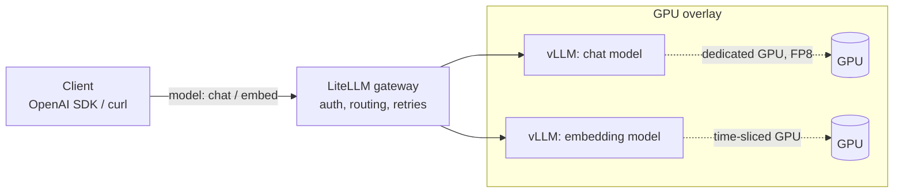

# llm-serving-k8s

[](https://github.com/alexboscolo954/llm-serving-k8s/actions/workflows/ci.yaml)

Serving open LLMs on Kubernetes with **vLLM** behind a **LiteLLM** gateway, on GPUs and on plain CPU.
Every claim below has a proof level: it either runs in CI, was measured on real GPUs, or is marked as rendered only.



Clients only see the gateway and a virtual model name (`chat`, `embed`).
Swapping the model behind a name, or moving it to other hardware, is a gateway config change, not a client change.

## What's proven, and how

| Feature | Proof level | Evidence |
|---|---|---|
| Gateway routes two virtual models to vLLM backends | **CI-proven** | [`tests/`](tests): chat, streaming, embeddings, bad key and unknown model rejected |
| Load-test harness (`vllm bench serve` as a Job) | **CI-proven** | [`bench/`](bench): runs through the gateway on every PR; CPU numbers check the harness, they are not a benchmark |
| Manifest rules: probes, memory limits, GPU requests, backends ClusterIP-only, pinned images | **CI-proven** | [`policies/`](policies): checked on every rendered overlay, and each rule is shown to fail on a broken manifest |
| FP8 chat model on a dedicated GPU | Render-only | [`overlays/gpu`](overlays/gpu) |
| Embeddings on a time-sliced GPU | Render-only | [`overlays/gpu`](overlays/gpu), [`platform/time-slicing-config.yaml`](platform/time-slicing-config.yaml) |
| GPU Operator, per-node GPU sharing profiles, OpenCost | Render-only | [`platform/`](platform) |

- **CI-proven**: runs end-to-end on a kind cluster in CI, CPU only.
- **Benchmarked**: measured in a recorded session on rented GPUs, with raw results and the exact setup committed.
- **Render-only**: rendered, schema-checked and policy-checked in CI, never executed.

Why the split: [ADR-0001](docs/adr/0001-every-claim-is-proven-or-labelled.md).

**Roadmap:** GPU benchmark session (FP8 vs BF16, dedicated vs time-sliced, gateway overhead), then observability, autoscaling, and multi-tenancy. Each lands as a release with its proof level.

## Quick start (CPU, about 10 minutes)

Requirements: Docker (8 GB of memory for Docker Desktop), `kind`, `kubectl`, Python 3 with `pytest`.

```bash
make up      # kind cluster + vLLM chat (Qwen2.5-0.5B) + vLLM embed (bge-small) + LiteLLM
make smoke   # one chat completion through the gateway
make test    # e2e tests against the gateway
make bench   # small load test; table in bench/results/<date>-cpu-kind/results.md
make down
```

Manual call:

```bash
kubectl -n llm port-forward svc/litellm 4000:4000 &
curl http://localhost:4000/v1/chat/completions \
  -H "Authorization: Bearer sk-local-dev" -H "Content-Type: application/json" \
  -d '{"model":"chat","messages":[{"role":"user","content":"Hi"}]}'
```

It's the same OpenAI-compatible server the GPU overlay uses, just slow.
CI runs it on x86 Linux. The image is multi-arch, but on Apple silicon (Docker Desktop) the chat model's CPU warmup can stall past the startup probe.

## GPU deployment

1. Install the platform layer:
   ```bash
   kubectl create ns gpu-operator
   kubectl apply -f platform/time-slicing-config.yaml
   helm install gpu-operator nvidia/gpu-operator --version v26.7.1 \
     -n gpu-operator -f platform/gpu-operator-values.yaml
   helm install opencost opencost/opencost --version 2.5.32 \
     -n opencost --create-namespace -f platform/opencost-values.yaml
   ```
2. Pick which nodes share their GPUs:
   ```bash
   kubectl label node <gpu-node-a> nvidia.com/device-plugin.config=dedicated
   kubectl label node <gpu-node-b> nvidia.com/device-plugin.config=shared
   ```
3. Create the secrets (`litellm-master-key`, and optionally `hf-token`), then `kubectl apply -k overlays/gpu`.

### Design choices

- **FP8 for the chat model**: half the weight memory of BF16, and the freed memory becomes KV cache, so more concurrent sequences per GPU. Needs Ada/Hopper or newer.
- **Dedicated vs. shared GPUs, per node**: a node label picks a device-plugin profile. Big models get a whole card; small ones share a card through time-slicing.
- **Time-slicing shares compute, not memory**: every pod on a shared card caps itself with `--gpu-memory-utilization`, and the caps must add up to less than 1.0. MIG gives hard isolation, but only on some GPUs and in fixed slice sizes.
- **Cost visibility with OpenCost**: on-prem has no cloud bill, so a custom price sheet (amortized hardware cost) plus per-pod GPU usage from the DCGM exporter.
- **Gateway in front of everything**: one auth point, retries and model aliases. vLLM backends stay ClusterIP-only, and a policy enforces it.
- **Startup probes sized for weight downloads**: the chat model's weights sit on a PVC, so restarts don't download them again.

## Repo layout

```
base/                 namespace + LiteLLM gateway (shared)
overlays/cpu-kind/    vLLM CPU chat + embed, kind config, demo secret
overlays/gpu/         FP8 chat model (dedicated GPU) + embeddings (time-sliced GPU)
platform/             GPU Operator, time-slicing config, OpenCost values
bench/                load-test Job, results table generator
tests/                e2e tests against the gateway
policies/             kyverno rules for rendered manifests
docs/adr/             architecture decision records
CONTEXT.md            glossary
```

Everything is plain Kustomize and upstream Helm charts with values files. There are no custom charts.

## Validation

`make validate` needs no cluster. It renders both overlays and both Helm charts, checks them with `kubeconform` and the kyverno CLI, and unit-tests the results generator.
Operator CRDs such as `ClusterPolicy` are skipped (`-ignore-missing-schemas`).
CI runs `validate` and the CPU end-to-end job on every pull request and on `main`.

## License

MIT
