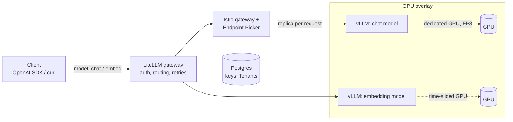
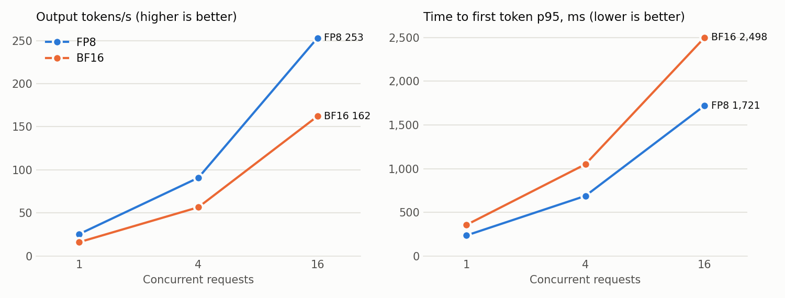

# llm-serving-k8s

[](https://github.com/alexboscolo954/llm-serving-k8s/actions/workflows/ci.yaml)

Serving open LLMs on Kubernetes with **vLLM** behind a **LiteLLM** gateway, on GPUs and on plain CPU.
Every claim below has a proof level: it either runs in CI, was measured on real GPUs, or is marked as rendered only.



Clients only see the gateway and a virtual model name (`chat`, `embed`).
Swapping the model behind a name, or moving it to other hardware, is a gateway config change, not a client change.

## What's proven, and how

| Feature | Proof level | Evidence |
|---|---|---|
| Gateway routes two virtual models to vLLM backends | **CI-proven** | [`tests/`](tests): chat, streaming, embeddings, bad key and unknown model rejected |
| Chat requests pick a replica per request (Gateway API Inference Extension): an Istio gateway asks the Endpoint Picker, which scores each replica's queue and KV cache | **CI-proven** | [`base/chat-routing.yaml`](base/chat-routing.yaml): every chat request in CI goes through it, and it is set to fail closed (`failureMode: FailClose`), so a chat request only succeeds if the picker chose its replica. In [`tests/test_autoscaling.py`](tests/test_autoscaling.py), after the load stops, the replica KEDA added finishes Gateway requests: 4 in the last 5 minutes, replica 0 139 (v0.4.0, through a Service, under load: 0 in a 2-minute window) |
| Tenants: each has its own keys and a requests-per-minute limit; one over its limit gets 429 while another keeps getting answers | **CI-proven** | [`tests/test_tenancy.py`](tests/test_tenancy.py): two Tenants (LiteLLM teams) created through the Gateway's admin API |
| Gateway keys in Postgres (CloudNativePG, one instance); unknown keys get 401 | **CI-proven** | [`base/litellm-db.yaml`](base/litellm-db.yaml), [`tests/test_gateway.py`](tests/test_gateway.py) |
| Backends only take traffic from the Gateway, Prometheus and pods labelled `llm-serving/direct-access=true` (NetworkPolicy, default deny) | **CI-proven** | [`base/network-policies.yaml`](base/network-policies.yaml), [`tests/test_tenancy.py`](tests/test_tenancy.py): a labelled pod reaches each Backend, an unlabelled one does not. Any pod in `llm` can set the label, so it is only as strict as pod creation there |
| Prometheus reads the Gateway's metrics with a key that can do nothing else | **CI-proven** | [`base/litellm-metrics-key.yaml`](base/litellm-metrics-key.yaml): the key reads `/metrics/` and gets 403 on chat; the observability job scrapes with it |
| Load-test harness (`vllm bench serve` as a Job) | **CI-proven** | [`bench/`](bench): runs through the gateway on every PR; CPU numbers check the harness, they are not a benchmark |
| Manifest rules: probes, memory limits, GPU requests, backends ClusterIP-only, pinned images | **CI-proven** | [`policies/`](policies): checked on every rendered overlay, and each rule is shown to fail on a broken manifest |
| FP8 chat model on a dedicated GPU: +56–60% throughput over BF16, 3.3× the KV cache | **Benchmarked** | [`bench/results/2026-10-16-l4`](bench/results/2026-10-16-l4): 1× L4, 3 repeats per point |
| Time-sliced GPU sharing: a busy neighbour costs the chat model 44% of its throughput | **Benchmarked** | [`bench/results/2026-10-22-l4`](bench/results/2026-10-22-l4#time-slicing-fp8-concurrency-16): chat alone on a shared L4 250 tok/s, next to an embedding Backend at about 75 requests/s 140 tok/s, ITL 51 → 113 ms. Corrects the first session's "unchanged", whose neighbour very likely never got a request |
| Gateway overhead (LiteLLM, Istio gateway, Endpoint Picker) | **Benchmarked** | [`bench/results/2026-10-22-l4`](bench/results/2026-10-22-l4#gateway-overhead-with-the-istio-hop): at 16 concurrent requests, about 790 ms more p95 TTFT (LiteLLM alone, first session: none) and about 520 ms more mean TTFT (LiteLLM alone: 400 ms) |
| GPU Operator on RKE2, per-node GPU sharing profiles | **Benchmarked** | [`platform/`](platform), [`bench/infra`](bench/infra): installed and used in the session |
| Metrics: Prometheus scrapes both Backends and the Gateway, and every Grafana dashboard query returns data from it | **CI-proven** | [`observability/`](observability), [`tests/test_observability.py`](tests/test_observability.py): checked under live traffic on the kind cluster |
| Alerts: p95 time to first token, KV cache above 90%, a queue that only grows | **CI-proven** | [`observability/vllm-rules.test.yaml`](observability/vllm-rules.test.yaml): each alert fires on a bad series and stays silent on a good one (`promtool`), and Prometheus loads them in CI. Thresholds are starting points, not tuned on a GPU |
| Autoscaling: the chat Backend goes from 1 to 2 replicas when requests queue (KEDA), and the new replica gets its own weights cache | **CI-proven** | [`autoscaling/`](autoscaling), [`tests/test_autoscaling.py`](tests/test_autoscaling.py): under load the queue builds, KEDA adds a replica, it gets its own PVC, becomes Ready and answers a request sent straight to it. The load stops before the routing check: two CPU replicas under full load stalled CI's 4-vCPU node |
| Autoscaling on GPUs | Render-only | [`overlays/gpu`](overlays/gpu): the same StatefulSet and ScaledObject render and pass the checks, but the Benchmark session had one GPU, so a second replica had nowhere to run |
| Postgres, NetworkPolicies and the Endpoint Picker on the GPU cluster (RKE2, Canal CNI) | **Benchmarked** | [`bench/results/2026-10-22-l4/e2e.txt`](bench/results/2026-10-22-l4/e2e.txt): CI's Gateway and Tenant e2e tests pass on the GPU cluster, every chat request through the picker. One GPU, so one replica: no choice between replicas on GPUs yet |
| GPU metrics (DCGM exporter) | **Benchmarked** | [`bench/results/2026-10-22-l4`](bench/results/2026-10-22-l4#cis-e2e-tests-on-rke2): Prometheus scrapes the GPU Operator's DCGM exporter; GPU utilisation per pod is in the results |
| Cost per Backend from an on-prem price sheet (OpenCost): each pod pays for the CPU and memory it holds | **CI-proven** | [`platform/opencost-values.yaml`](platform/opencost-values.yaml), [`tests/test_cost.py`](tests/test_cost.py): node prices in Prometheus are the sheet's, and each Backend's CPU and memory cost is its core-hours and GiB-hours at those prices (within 1%; OpenCost's defaults are 5–6% off) |
| GPU cost per Backend: right on a dedicated card, 2× too high on a time-sliced one | **Benchmarked** | [`bench/results/2026-10-22-l4-cost`](bench/results/2026-10-22-l4-cost): chat holding a whole L4 is charged $2.50 an hour. On a time-sliced L4, chat and embed are each charged a whole card, $5.00 an hour for one GPU: OpenCost marked neither pod as sharing a card |

- **CI-proven**: runs end-to-end on a kind cluster in CI, CPU only.
- **Benchmarked**: measured in a recorded session on rented GPUs, with raw results and the exact setup committed.
- **Render-only**: rendered, schema-checked and policy-checked in CI, never executed.

Why the split: [ADR-0001](docs/adr/0001-every-claim-is-proven-or-labelled.md).

## GPU results: FP8 vs BF16 on one L4

<picture>
  <source media="(prefers-color-scheme: dark)" srcset="bench/results/2026-10-16-l4/fp8-vs-bf16-dark.png">
  
</picture>

| Concurrency | FP8 tok/s | BF16 tok/s | FP8 TTFT p95 | BF16 TTFT p95 |
|---|---|---|---|---|
| 1 | 25.5 | 16.2 | 236 ms | 356 ms |
| 4 | 90.9 | 56.7 | 688 ms | 1,050 ms |
| 16 | 253.0 | 162.2 | 1,721 ms | 2,498 ms |
| 64 | 403.3 | did not finish in 58 min | 25,449 ms | n/a |

Qwen3-8B, vLLM v0.31.0, 1024 input / 256 output tokens, median of 3 runs. At 64 concurrent requests BF16's KV cache holds only about 16 of them; the run did not finish within the VM's time cap.
Full write-up, method, and the bug this session found in the GPU overlay: [`bench/results/2026-10-16-l4`](bench/results/2026-10-16-l4).

**Next:** autoscaling and the Endpoint Picker's choice between replicas on GPUs, which need a second GPU (GCP quota for it was denied).

## Quick start (CPU, about 10 minutes)

Requirements: Docker (8 GB of memory for Docker Desktop), `kind`, `kubectl`, `helm`, Python 3 with `pytest`.

```bash
make up      # kind cluster + vLLM chat (Qwen2.5-0.5B) + vLLM embed (bge-small) + LiteLLM and its Postgres + Istio gateway and Endpoint Picker
make smoke   # one chat completion through the gateway
make test    # e2e tests: routing, Tenants, NetworkPolicies
make bench   # small load test; table in bench/results/<date>-cpu-kind/results.md
make observe             # Prometheus + Grafana, scraping the Backends and the Gateway
make cost                # OpenCost on the price sheet in platform/opencost-values.yaml
make test-observability  # targets up, every dashboard query returns data, alert rules loaded, cost at sheet prices
make autoscale           # KEDA, scaling the chat Backend on its queue (after make observe)
make test-autoscaling    # load until KEDA adds a chat replica, then check the Gateway uses it
make down
```

`make observe` and `make autoscale` have only run on CI's 16 GB runner; next to both Backends it may not fit in Docker Desktop's 8 GB.

Manual call:

```bash
kubectl -n llm port-forward svc/litellm 4000:4000 &
curl http://localhost:4000/v1/chat/completions \
  -H "Authorization: Bearer sk-local-dev" -H "Content-Type: application/json" \
  -d '{"model":"chat","messages":[{"role":"user","content":"Hi"}]}'
```

It's the same OpenAI-compatible server the GPU overlay uses, just slow.
CI runs it on x86 Linux. The image is multi-arch, but on Apple silicon (Docker Desktop) the chat model's CPU warmup can stall past the startup probe.
The CPU Backends run without Triton-CPU, on vLLM's V1 model runner. Triton-CPU builds kernels for the CPU model's name. Some CI runners are EPYC 9V74 VMs that hide AVX-512, and on those every Triton kernel died with an illegal instruction ([PR #10](https://github.com/alexboscolo954/llm-serving-k8s/pull/10)).

## GPU deployment

1. Install the platform layer:
   ```bash
   kubectl create ns gpu-operator
   kubectl apply -f platform/time-slicing-config.yaml
   helm install gpu-operator nvidia/gpu-operator --version v26.7.1 \
     -n gpu-operator -f platform/gpu-operator-values.yaml
   helm install kube-prometheus-stack prometheus-community/kube-prometheus-stack --version 92.10.1 \
     -n monitoring --create-namespace -f platform/kube-prometheus-stack-values.yaml
   helm install opencost opencost/opencost --version 2.5.33 \
     -n opencost --create-namespace -f platform/opencost-values.yaml
   helm install keda kedacore/keda --version 2.21.0 -n keda --create-namespace
   make platform   # Gateway API and Inference Extension CRDs, CloudNativePG, Istio (gateway only)
   ```
2. Pick which nodes share their GPUs:
   ```bash
   kubectl label node <gpu-node-a> nvidia.com/device-plugin.config=dedicated
   kubectl label node <gpu-node-b> nvidia.com/device-plugin.config=shared
   ```
3. Create the secrets (`litellm-master-key`, `litellm-metrics-key`, and optionally `hf-token`), then `kubectl apply -k overlays/gpu`, `kubectl apply -k observability` and `kubectl apply -k autoscaling`.

### Run a benchmark session

Needs a GCP project with L4 quota, `gcloud` and `terraform`. The VM deletes itself after 5 hours whatever happens.

```bash
export TF_VAR_project=<gcp-project-id> TF_VAR_billing_account=<billing-account-id>
make bench-up ZONE=us-west1-a SPOT=false   # g2-standard-12 + RKE2, kubeconfig in ~/k8s_clusters/llm-bench-l4.yaml
make bench-gpu                             # platform, e2e, overhead, shared; results in bench/results/<date>-l4
make bench-down                            # destroy, then check nothing is left running
```

Spot L4s were out of stock in most zones on the first attempt and reclaimed within two minutes in the one that had them; on-demand costs about $1/hour.

### Design choices

- **FP8 for the chat model**: half the weight memory of BF16, and the freed memory becomes KV cache, so more concurrent sequences per GPU (measured: 3.3× the KV cache, +56–60% throughput on an L4). Needs Ada/Hopper or newer.
- **Dedicated vs. shared GPUs, per node**: a node label picks a device-plugin profile. Big models get a whole card; small ones share a card through time-slicing.
- **Time-slicing shares compute, not memory**: every pod on a shared card caps itself with `--gpu-memory-utilization`, and the caps must add up to less than 1.0. Compute is shared by taking turns, with no isolation: a busy neighbour cost the chat model 44% of its throughput. MIG gives hard isolation, but only on some GPUs and in fixed slice sizes.
- **Cost visibility with OpenCost**: on-prem has no cloud bill, so cost comes from a custom price sheet (amortized hardware cost per core, GiB and GPU hour), with OpenCost's cloud detection turned off: on a GCE VM it discounted the sheet's CPU and RAM by 30%. Tenants are Gateway teams, not namespaces, so OpenCost reports cost per Backend, not per Tenant. A time-sliced card is charged once per Backend on it, so shared GPUs need their cost divided by hand.
- **Gateway in front of everything**: one auth point, retries and model aliases. vLLM backends stay ClusterIP-only, and a policy enforces it.
- **Metrics from both layers**: vLLM exposes queue length, KV cache usage and time to first token per Backend; LiteLLM's open-source build adds Gateway request and failure counts once `callbacks: ["prometheus"]` is set. Its `/metrics/` endpoint wants a valid key, so the PodMonitor sends one that may only read metrics: the Prometheus Operator copies it into a Secret in `monitoring`, where the master key has no business.
- **Alert on saturation, not load**: a full KV cache or a queue that keeps growing means the Backend is short of capacity. A busy Backend whose queue holds steady does not page anyone.
- **Scale on the queue, not on utilization**: a Backend that keeps up runs near 100% GPU and needs nothing; requests waiting in vLLM's queue mean it doesn't keep up. KEDA reads that from Prometheus and adds replicas, minimum one: a GPU cold start takes minutes, so scale-to-zero would leave clients waiting.
- **Every chat replica has its own weights cache**: the chat Backend is a StatefulSet, so each replica gets its own PVC, and a scaled-down replica finds its weights again when it comes back ([ADR-0002](docs/adr/0002-statefulset-per-replica-weights-cache.md)). Scale-down waits 10 minutes, longer than a cold start.
- **Pick the replica per request, behind the Gateway**: a Service balances connections, and LiteLLM keeps its connections open, so a new replica got nothing. The Endpoint Picker scores every replica on each request; LiteLLM stays the only entry point ([ADR-0003](docs/adr/0003-per-request-routing-behind-the-gateway.md)). If the picker is down, chat fails rather than quietly falling back.
- **Tenants are Gateway teams**: a Tenant is a LiteLLM team with its own keys and limits, stored in Postgres. No per-Tenant Kubernetes objects, so adding one is an API call, not a deploy.
- **NetworkPolicies on ingress only**: nothing in `llm` takes traffic unless a policy lets it in. Egress stays open, because Backends download weights and the Gateway calls them.
- **Startup probes sized for weight downloads**: the chat model's weights sit on a PVC, so restarts don't download them again.

## Repo layout

```
base/                 namespace, LiteLLM gateway, its Postgres, NetworkPolicies, chat routing (shared)
overlays/cpu-kind/    vLLM CPU chat + embed, kind config, demo secret
overlays/gpu/         FP8 chat model (dedicated GPU) + embeddings (time-sliced GPU)
platform/             GPU Operator, time-slicing config, Prometheus stack, OpenCost and istiod values
observability/        PodMonitors, alert rules with their unit tests, Grafana dashboard
autoscaling/          KEDA ScaledObject for the chat Backend
bench/                load-test Job, results table and chart, GPU session script
bench/infra/          Terraform for the benchmark VM (GCP L4, RKE2)
tests/                e2e tests against the gateway
policies/             kyverno rules for rendered manifests
docs/adr/             architecture decision records
CONTEXT.md            glossary
```

Everything is plain Kustomize and upstream Helm charts with values files. There are no custom charts.

## Validation

`make validate` needs no cluster. It renders both overlays, the observability manifests and the six Helm charts, checks them with `kubeconform` and the kyverno CLI, unit-tests the alert rules with `promtool` and the results generator with `pytest`, and runs `shellcheck` on the session scripts.
Operator CRDs such as `ClusterPolicy` are skipped (`-ignore-missing-schemas`), and so is `InferencePool`, which the public schema catalog does not have yet.
CI runs `validate` and three CPU end-to-end jobs (Gateway, observability, autoscaling), each on its own kind cluster, on every pull request and on `main`.

## License

MIT
