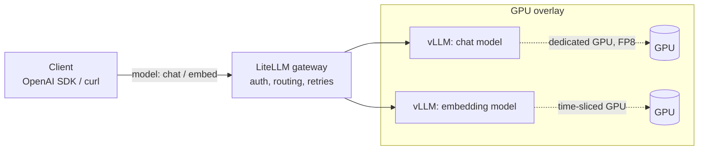

# llm-serving-k8s

[](https://github.com/alexboscolo954/llm-serving-k8s/actions/workflows/ci.yaml)

Serving open LLMs on Kubernetes with **vLLM** behind a **LiteLLM** gateway, on GPUs and on plain CPU.
Every claim below has a proof level: it either runs in CI, was measured on real GPUs, or is marked as rendered only.



Clients only see the gateway and a virtual model name (`chat`, `embed`).
Swapping the model behind a name, or moving it to other hardware, is a gateway config change, not a client change.

## What's proven, and how

| Feature | Proof level | Evidence |
|---|---|---|
| Gateway routes two virtual models to vLLM backends | **CI-proven** | [`tests/`](tests): chat, streaming, embeddings, bad key and unknown model rejected |
| Load-test harness (`vllm bench serve` as a Job) | **CI-proven** | [`bench/`](bench): runs through the gateway on every PR; CPU numbers check the harness, they are not a benchmark |
| Manifest rules: probes, memory limits, GPU requests, backends ClusterIP-only, pinned images | **CI-proven** | [`policies/`](policies): checked on every rendered overlay, and each rule is shown to fail on a broken manifest |
| FP8 chat model on a dedicated GPU: +56–60% throughput over BF16, 3.3× the KV cache | **Benchmarked** | [`bench/results/2026-10-16-l4`](bench/results/2026-10-16-l4): 1× L4, 3 repeats per point |
| Embeddings on a time-sliced GPU (run next to the chat model in the session) | **Benchmarked** | [`bench/results/2026-10-16-l4`](bench/results/2026-10-16-l4#time-slicing-fp8-concurrency-16): chat throughput unchanged; neighbour load level not recorded |
| Gateway overhead | **Benchmarked** | [`bench/results/2026-10-16-l4`](bench/results/2026-10-16-l4#gateway-overhead-fp8-concurrency-16): same throughput and p95, about 400 ms higher mean TTFT |
| GPU Operator on RKE2, per-node GPU sharing profiles | **Benchmarked** | [`platform/`](platform), [`bench/infra`](bench/infra): installed and used in the session |
| Metrics: Prometheus scrapes both Backends and the Gateway, and every Grafana dashboard query returns data from it | **CI-proven** | [`observability/`](observability), [`tests/test_observability.py`](tests/test_observability.py): checked under live traffic on the kind cluster |
| Alerts: p95 time to first token, KV cache above 90%, a queue that only grows | **CI-proven** | [`observability/vllm-rules.test.yaml`](observability/vllm-rules.test.yaml): each alert fires on a bad series and stays silent on a good one (`promtool`), and Prometheus loads them in CI. Thresholds are starting points, not tuned on a GPU |
| GPU metrics (DCGM exporter) | Render-only | [`platform/`](platform): the GPU Operator's ClusterPolicy asks for a DCGM ServiceMonitor (the operator creates it at runtime) and Prometheus accepts monitors from any release. DCGM metrics have never been scraped |
| OpenCost | Render-only | [`platform/opencost-values.yaml`](platform/opencost-values.yaml): points at the Prometheus above, but OpenCost itself has not been run |

- **CI-proven**: runs end-to-end on a kind cluster in CI, CPU only.
- **Benchmarked**: measured in a recorded session on rented GPUs, with raw results and the exact setup committed.
- **Render-only**: rendered, schema-checked and policy-checked in CI, never executed.

Why the split: [ADR-0001](docs/adr/0001-every-claim-is-proven-or-labelled.md).

## GPU results: FP8 vs BF16 on one L4

<picture>
  <source media="(prefers-color-scheme: dark)" srcset="bench/results/2026-10-16-l4/fp8-vs-bf16-dark.png">
  
</picture>

| Concurrency | FP8 tok/s | BF16 tok/s | FP8 TTFT p95 | BF16 TTFT p95 |
|---|---|---|---|---|
| 1 | 25.5 | 16.2 | 236 ms | 356 ms |
| 4 | 90.9 | 56.7 | 688 ms | 1,050 ms |
| 16 | 253.0 | 162.2 | 1,721 ms | 2,498 ms |
| 64 | 403.3 | did not finish in 58 min | 25,449 ms | n/a |

Qwen3-8B, vLLM v0.31.0, 1024 input / 256 output tokens, median of 3 runs. At 64 concurrent requests BF16's KV cache holds only about 16 of them; the run did not finish within the VM's time cap.
Full write-up, method, and the bug this session found in the GPU overlay: [`bench/results/2026-10-16-l4`](bench/results/2026-10-16-l4).

**Roadmap:** autoscaling and multi-tenancy. Each lands as a release with its proof level.

## Quick start (CPU, about 10 minutes)

Requirements: Docker (8 GB of memory for Docker Desktop), `kind`, `kubectl`, Python 3 with `pytest`; `helm` for `make observe`.

```bash
make up      # kind cluster + vLLM chat (Qwen2.5-0.5B) + vLLM embed (bge-small) + LiteLLM
make smoke   # one chat completion through the gateway
make test    # e2e tests against the gateway
make bench   # small load test; table in bench/results/<date>-cpu-kind/results.md
make observe             # Prometheus + Grafana, scraping the Backends and the Gateway
make test-observability  # targets up, every dashboard query returns data, alert rules loaded
make down
```

`make observe` has only run on CI's 16 GB runner; next to both Backends it may not fit in Docker Desktop's 8 GB.

Manual call:

```bash
kubectl -n llm port-forward svc/litellm 4000:4000 &
curl http://localhost:4000/v1/chat/completions \
  -H "Authorization: Bearer sk-local-dev" -H "Content-Type: application/json" \
  -d '{"model":"chat","messages":[{"role":"user","content":"Hi"}]}'
```

It's the same OpenAI-compatible server the GPU overlay uses, just slow.
CI runs it on x86 Linux. The image is multi-arch, but on Apple silicon (Docker Desktop) the chat model's CPU warmup can stall past the startup probe.

## GPU deployment

1. Install the platform layer:
   ```bash
   kubectl create ns gpu-operator
   kubectl apply -f platform/time-slicing-config.yaml
   helm install gpu-operator nvidia/gpu-operator --version v26.7.1 \
     -n gpu-operator -f platform/gpu-operator-values.yaml
   helm install kube-prometheus-stack prometheus-community/kube-prometheus-stack --version 92.10.1 \
     -n monitoring --create-namespace -f platform/kube-prometheus-stack-values.yaml
   helm install opencost opencost/opencost --version 2.5.32 \
     -n opencost --create-namespace -f platform/opencost-values.yaml
   ```
2. Pick which nodes share their GPUs:
   ```bash
   kubectl label node <gpu-node-a> nvidia.com/device-plugin.config=dedicated
   kubectl label node <gpu-node-b> nvidia.com/device-plugin.config=shared
   ```
3. Create the secrets (`litellm-master-key`, and optionally `hf-token`), then `kubectl apply -k overlays/gpu` and `kubectl apply -k observability`.

### Run a benchmark session

Needs a GCP project with L4 quota, `gcloud` and `terraform`. The VM deletes itself after 5 hours whatever happens.

```bash
export TF_VAR_project=<gcp-project-id> TF_VAR_billing_account=<billing-account-id>
make bench-up ZONE=us-west1-a SPOT=false   # g2-standard-12 + RKE2, kubeconfig in ~/k8s_clusters/llm-bench-l4.yaml
make bench-gpu                             # platform, fp8, gateway, shared, bf16; results in bench/results/<date>-l4
make bench-down                            # destroy, then check nothing is left running
```

Spot L4s were out of stock in most zones on the first attempt and reclaimed within two minutes in the one that had them; on-demand costs about $1/hour.

### Design choices

- **FP8 for the chat model**: half the weight memory of BF16, and the freed memory becomes KV cache, so more concurrent sequences per GPU (measured: 3.3× the KV cache, +56–60% throughput on an L4). Needs Ada/Hopper or newer.
- **Dedicated vs. shared GPUs, per node**: a node label picks a device-plugin profile. Big models get a whole card; small ones share a card through time-slicing.
- **Time-slicing shares compute, not memory**: every pod on a shared card caps itself with `--gpu-memory-utilization`, and the caps must add up to less than 1.0. MIG gives hard isolation, but only on some GPUs and in fixed slice sizes.
- **Cost visibility with OpenCost**: on-prem has no cloud bill, so a custom price sheet (amortized hardware cost) plus per-pod GPU usage from the DCGM exporter.
- **Gateway in front of everything**: one auth point, retries and model aliases. vLLM backends stay ClusterIP-only, and a policy enforces it.
- **Metrics from both layers**: vLLM exposes queue length, KV cache usage and time to first token per Backend; LiteLLM's open-source build adds Gateway request and failure counts once `callbacks: ["prometheus"]` is set. Its `/metrics/` endpoint wants a valid key, so the PodMonitor sends one.
- **Alert on saturation, not load**: a full KV cache or a queue that keeps growing means the Backend is short of capacity. A busy Backend whose queue holds steady does not page anyone.
- **Startup probes sized for weight downloads**: the chat model's weights sit on a PVC, so restarts don't download them again.

## Repo layout

```
base/                 namespace + LiteLLM gateway (shared)
overlays/cpu-kind/    vLLM CPU chat + embed, kind config, demo secret
overlays/gpu/         FP8 chat model (dedicated GPU) + embeddings (time-sliced GPU)
platform/             GPU Operator, time-slicing config, Prometheus stack and OpenCost values
observability/        PodMonitors, alert rules with their unit tests, Grafana dashboard
bench/                load-test Job, results table and chart, GPU session script
bench/infra/          Terraform for the benchmark VM (GCP L4, RKE2)
tests/                e2e tests against the gateway
policies/             kyverno rules for rendered manifests
docs/adr/             architecture decision records
CONTEXT.md            glossary
```

Everything is plain Kustomize and upstream Helm charts with values files. There are no custom charts.

## Validation

`make validate` needs no cluster. It renders both overlays, the observability manifests and the three Helm charts, checks them with `kubeconform` and the kyverno CLI, unit-tests the alert rules with `promtool` and the results generator with `pytest`.
Operator CRDs such as `ClusterPolicy` are skipped (`-ignore-missing-schemas`).
CI runs `validate` and two CPU end-to-end jobs (Gateway, observability), each on its own kind cluster, on every pull request and on `main`.

## License

MIT
