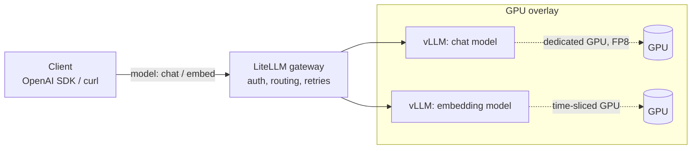

# llm-serving-k8s

[](https://github.com/alexboscolo954/llm-serving-k8s/actions/workflows/ci.yaml)

Serving open LLMs on Kubernetes with **vLLM** behind a **LiteLLM** gateway.
There are two deployment targets, and they share the same base:

| Target | Where it runs | How it's tested |
|---|---|---|
| [`overlays/cpu-kind`](overlays/cpu-kind) | Your laptop or any CI runner (kind, CPU only) | **Runs end-to-end in CI**: deploys and answers a real chat completion |
| [`overlays/gpu`](overlays/gpu) + [`platform/`](platform) | A cluster with NVIDIA GPUs | Rendered and schema-validated in CI. Not executed, because CI has no GPUs |



Clients only see the gateway and a virtual model name (`chat`, `embed`).
Swapping the model behind a name, or moving it to other hardware, is a gateway config change, not a client change.

## Quick start (CPU, about 10 minutes)

Requirements: Docker (8 GB of memory for Docker Desktop), `kind`, `kubectl`.

```bash
make up      # kind cluster + vLLM (Qwen2.5-0.5B on CPU) + LiteLLM
make smoke   # chat completion through the gateway
make down
```

`make smoke` prints the model name and the reply. Manual call:

```bash
kubectl -n llm port-forward svc/litellm 4000:4000 &
curl http://localhost:4000/v1/chat/completions \
  -H "Authorization: Bearer sk-local-dev" -H "Content-Type: application/json" \
  -d '{"model":"chat","messages":[{"role":"user","content":"Hi"}]}'
```

The vLLM CPU image is multi-arch, so this runs on x86 Linux and on Apple silicon through Docker Desktop.
It's slow but real. It's the same OpenAI-compatible server the GPU overlay uses.

## GPU deployment

1. Install the platform layer:
   ```bash
   kubectl create ns gpu-operator
   kubectl apply -f platform/time-slicing-config.yaml
   helm install gpu-operator nvidia/gpu-operator --version v26.7.1 \
     -n gpu-operator -f platform/gpu-operator-values.yaml
   helm install opencost opencost/opencost --version 2.5.32 \
     -n opencost --create-namespace -f platform/opencost-values.yaml
   ```
2. Pick which nodes share their GPUs:
   ```bash
   kubectl label node <gpu-node-a> nvidia.com/device-plugin.config=dedicated
   kubectl label node <gpu-node-b> nvidia.com/device-plugin.config=shared
   ```
3. Create the secrets (`litellm-master-key`, and optionally `hf-token`), then `kubectl apply -k overlays/gpu`.

### Design choices

- **FP8 for the chat model** (`--quantization=fp8`). The weights take about half the memory of BF16, and the freed memory goes to KV cache, which means more concurrent sequences per GPU. It needs Ada/Hopper-class GPUs or newer.
- **Dedicated vs. shared GPUs, chosen per node.** The device-plugin ConfigMap has two profiles, and a node label picks one. Big models get a whole card. Small models (embeddings, guards) share a card through time-slicing.
- **Time-slicing shares compute, not memory.** Nothing stops two pods on a shared card from both allocating 90%. Every pod on a shared node caps itself with `--gpu-memory-utilization`, and the caps on one card must add up to less than 1.0. MIG gives hard isolation, but only on GPUs that support it, and only in fixed slice sizes.
- **Cost visibility with OpenCost.** On-prem there's no cloud bill, so OpenCost uses a custom price sheet (put your amortized hardware cost there). It reads per-pod GPU usage from the DCGM exporter, which the GPU Operator ships.
- **Gateway in front of everything.** LiteLLM provides one auth point, retries, and model aliases. vLLM pods stay internal (ClusterIP only).
- **Startup probes sized for weight downloads.** The first start pulls several GB. The chat model's weights sit on a PVC, so restarts don't download them again.

## Repo layout

```
base/                 namespace + LiteLLM gateway (shared)
overlays/cpu-kind/    vLLM CPU, 0.5B model, kind config, demo secret
overlays/gpu/         FP8 chat model (dedicated GPU) + embeddings (time-sliced GPU)
platform/             GPU Operator, time-slicing config, OpenCost values
Makefile              up / smoke / down / validate
```

Everything is plain Kustomize and upstream Helm charts with values files. There are no custom charts.

## Validation

`make validate` renders both overlays and both Helm charts and checks them with `kubeconform`.
Operator CRDs such as `ClusterPolicy` are skipped (`-ignore-missing-schemas`).
CI runs `validate` plus the CPU end-to-end job on every push.

## License

MIT
